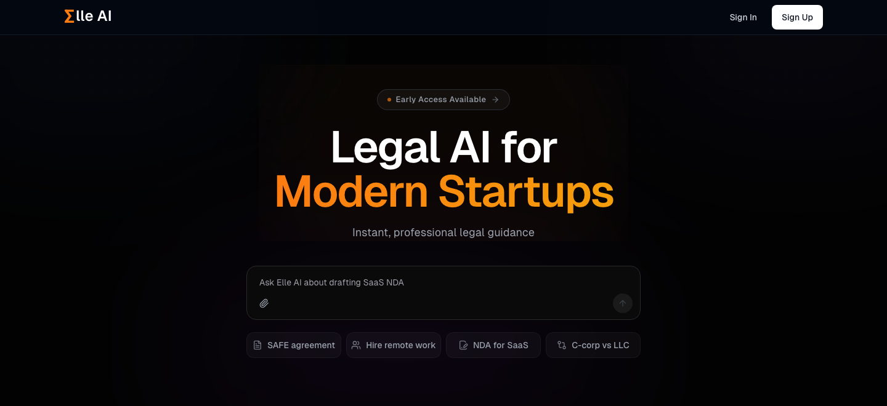
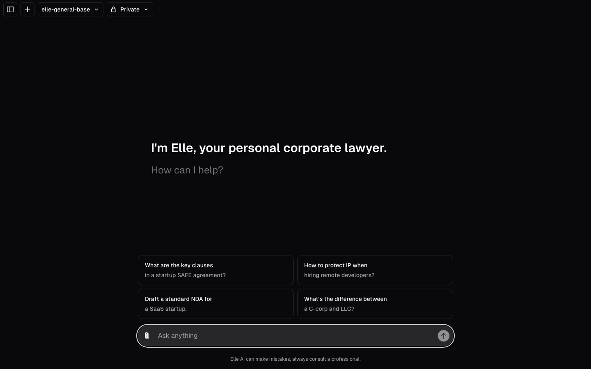
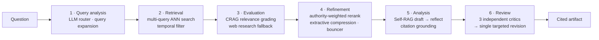

<div align="center">

# Σlle AI

**An agentic legal-research engine for startups — multi-stage RAG over federal law, with authority-tiered retrieval, self-reflective generation and adversarial critic review. Every claim cites its source.**

[Live demo](https://elle-psi.vercel.app) · [Architecture](#architecture) · [Retrieval pipeline](#the-retrieval-pipeline) · [Knowledge base](#knowledge-base) · [Run locally](#run-locally)




</div>

Elle treats a legal question as a research task, not a completion. A question like *"draft an NDA for a SaaS company"* is routed, decomposed into sub-queries, embedded and searched against a corpus of federal regulations, graded for relevance, reranked by legal authority, compressed, filtered for the founder's company stage, drafted with self-reflection, and then reviewed by three independent critic agents before a single revised document — with resolvable `[Source N]` citations — opens in the editor. Each stage streams its status to the UI as it runs.

> Informational only — not legal advice.

## What makes it different

- **Citation grounding, enforced** — every factual claim must trace to a `[Source N]` marker that resolves to a statute, regulation or guidance document. A verification pass extracts and validates each citation; claims without one are flagged as unverified. Citations are post-processed to APA form and foundational doctrines are auto-hyperlinked inline.
- **Authority-tiered retrieval** — every chunk is classified at ingest time: Tier 1 (statutes, regulations, case law, official guidance), Tier 2 (law-firm advisories, standards), Tier 3 (news, blogs, open web). Tier drives reranking (semantic rank score + tier boost, with a hard rule that Tier 3 never outranks relevant Tier 1), context budgeting, and the ordering the drafting model sees.
- **Corrective and self-reflective RAG** — a CRAG grader scores each retrieved chunk and declares the evidence set sufficient only when ≥ 2 documents are highly relevant, otherwise triggering live web research; a Self-RAG reflection pass audits the draft for unsupported claims and regenerates when it finds any.
- **Stage-aware context pruning** — a "bouncer" agent detects the company stage from the query (pre-seed / SAFE → *early*, Series A–B → *growth*, IPO / 10-K → *late*, M&A) and strips chunks calibrated for the wrong stage, with explicit forbidden combinations so public-company disclosure rules never reach a seed-stage draft.
- **Adversarial critic ensemble** — three single-responsibility critics review the draft independently: a *Commercial Pragmatist* (is the advice actionable for an operator), a *Compliance Officer* (regulatory attribution and liability constraints only), and a *Structural Auditor* (tables, lists, footnotes and comparison matrices, hunting hallucinated cells — runs only when structured elements exist). Their findings are merged into one targeted revision.
- **16 industry personas** — base / pro variants across general, healthcare, e-commerce, SaaS, EdTech, real estate, travel and esports, each with industry-specific guardrails baked into the system prompt (HIPAA / Stark / AKS, FTC / UCPD, SOC 2, FERPA / COPPA, …).
- **Observable by design** — pipeline phases are emitted as typed data-stream events and rendered as a live thought-process timeline in the chat; the final answer opens as a side-by-side artifact with version history, inline suggestions and one-click export to Google Docs through the Drive API.

<div align="center"></div>

## Architecture

```
                     ┌──────────────────────────────────────────────────────────────┐
  browser ──SSE──▶   │  app/(chat)/api/chat   ·  GenSX ExecuteChat workflow          │
  (timeline, artifact│    StreamText(model, system=persona, tools, maxSteps=8)        │
   editor, chat)     │    tools: legalSearch · webSearch · createDocument · updateDoc │
                     │           requestSuggestions · calculator · getDate · mcp     │
                     └───────────────┬──────────────────────────────────────────────┘
                                     │ legalSearch(query, industry?, recentOnly?)
                                     ▼
          ┌──────────────────────────────────────────────────────────────────────┐
          │  lib/ai/tools/legal-search.ts — six-phase research pipeline          │
          │  status events ──▶ data stream ──▶ <ThoughtProcessTimeline/>          │
          └───────┬───────────────────────────┬──────────────────────────────────┘
                  │ embedQuery                │ generateText (route · grade · rerank
                  ▼                           ▼  compress · bounce · draft · reflect · critique)
     ┌─────────────────────┐        ┌──────────────────────────┐
     │ ChromaDB (HNSW)     │        │ lib/ai/providers.ts      │
     │ legal-documents     │        │ DeepSeek chat / R1 ◀─┐   │
     │ local or Cloud      │        │ Mistral Large        │   │   custom fetch shim injects
     └─────────▲───────────┘        │ extractReasoning MW  │   │   reasoning_content for R1
               │ ingest             └──────────────────────┼───┘
     ┌─────────┴───────────────────────────────────────────┘
     │ scripts/ — eCFR · Federal Register · seeded doctrines
     │ lib/rag/chunker.ts — 2 000-char / 400-char overlap · deriveAuthorityTier()
     └─────────────────────────────────────────────────────────────────────────
```

Postgres (Drizzle) persists users, chats, messages, documents, document versions, suggestions and votes. `chromadb` and `onnxruntime-node` are dynamically imported and externalised from the Next.js server bundle so the Node runtime loads them only inside the tool.

## The retrieval pipeline

`legalSearch` ([`lib/ai/tools/legal-search.ts`](lib/ai/tools/legal-search.ts)) runs six phases; each emits `Phase::step` status events consumed by the timeline.



| Phase | Mechanism | Design intent |
|---|---|---|
| **Query analysis** | An LLM router selects sources (knowledge base, web, or both) given live collection size; the query is expanded into complementary sub-queries | A single embedding under-covers multi-issue legal questions |
| **Retrieval** | Each sub-query is embedded (`text-embedding-3-small`) and searched in Chroma; results are deduplicated and, with `recentOnly`, documents older than 3 years are deprioritised — undated primary law is never dropped | Regulations drift; statutes don't expire |
| **Evaluation** | Corrective-RAG grader labels each chunk relevant / irrelevant and the set sufficient / insufficient; insufficiency triggers web research whose results are tiered on the way in | Never draft from weak evidence |
| **Refinement** | LLM reranker produces a semantic order; final score = rank score + authority-tier boost with a Tier-1-over-Tier-3 invariant; extractive compression keeps only query-relevant passages; the bouncer agent removes stage-inappropriate chunks | Right law, right stage, minimal tokens |
| **Analysis** | Draft against tiered context; Self-RAG reflection enumerates hallucinations and suggestions and regenerates if any exist; every `[Source N]` is extracted and validated against the retrieved set | Catch unsupported claims before review, not after |
| **Review** | Pragmatist, Compliance and Structural critics each return `needsRevision` + findings; one revision pass applies all three. Output is structured RISK → CONTRACTUAL FIX → OPERATIONAL FIX | Practitioner-grade output for operators, not law students |

## Knowledge base

`pnpm db:ingest` builds the `legal-documents` Chroma collection — chunked at ~500 tokens with ~100-token overlap, each chunk carrying industry, document type, source URL, date and a derived authority tier.

| Source | Scope |
|---|---|
| **eCFR** — [`scripts/ingest-ecfr.ts`](scripts/ingest-ecfr.ts) | 14 CFR titles mapped to verticals: 21 (FDA), 42, 45 (HHS / HIPAA), 16 (FTC), 15, 47 (FCC), 34 (Education), 12, 24 (HUD), 14 (FAA), 46, 31, 28, 29 (Labor) |
| **Federal Register** — [`scripts/ingest-federal-register.ts`](scripts/ingest-federal-register.ts) | Recent rulemaking from 14 agencies: FDA, HHS, CMS, FTC, CPSC, FCC, ED, HUD, CFPB, DOT, FAA, TSA, DOJ, FinCEN |
| **Seeded doctrines** — [`scripts/seed_legal_concepts.py`](scripts/seed_legal_concepts.py) | ~25 foundational concepts the critics expect to see applied — present assignment vs. promise to assign (*Stanford v. Roche*), GPL vs. AGPL copyleft for SaaS, DTSA §1833(b) whistleblower notice, state IP carve-outs, New York Convention arbitration — auto-linked inline in answers |

## Stack

| | |
|---|---|
| App | Next.js 15 (App Router, RSC), React 18, TypeScript, Tailwind, Radix / shadcn, Framer Motion |
| Orchestration | Vercel AI SDK `streamText` with multi-step tool use, composed as GenSX components; typed data-stream events for pipeline telemetry |
| Models | DeepSeek `deepseek-chat` + `deepseek-reasoner` (R1) by default — with `extractReasoningMiddleware` and an HTTP-level shim that injects `reasoning_content` on assistant turns, which the R1 API requires; Mistral Large via `AI_PROVIDER=mistral` |
| Retrieval | ChromaDB (local server or Chroma Cloud) over OpenAI `text-embedding-3-small`; per-user 5-minute result cache bridging the tool to document creation |
| Data | Postgres via Drizzle ORM with versioned migrations; Vercel Blob for attachments |
| Auth | NextAuth — credentials, Google (Drive / Docs scopes for export), GitHub |
| Deploy | Vercel |

## Run locally

Prerequisites: Node 18+, pnpm, Python 3 (seed script), Postgres, and either a local Chroma (`pip install chromadb`) or Chroma Cloud.

```bash
git clone https://github.com/Henry-Shan/Elle.git && cd Elle
pnpm install
cp .env.example .env.local        # fill in the values below

pnpm db:migrate                   # Postgres schema
pnpm chroma                       # terminal 2: local vector store on :8000
pnpm db:ingest                    # seeded doctrines + eCFR + Federal Register
pnpm dev                          # http://localhost:3000
```

| Variable | Purpose |
|---|---|
| `POSTGRES_URL` | Postgres connection string |
| `AUTH_SECRET` | NextAuth session secret |
| `AI_PROVIDER` | `deepseek` (default) or `mistral` |
| `DEEPSEEK_API_KEY` / `MISTRAL_API_KEY` | Chat, pipeline and critic models |
| `OPENAI_API_KEY` | Embeddings only |
| `CHROMA_HOST`, `CHROMA_PORT` | Local Chroma (default `localhost:8000`) |
| `CHROMA_API_KEY`, `CHROMA_TENANT`, `CHROMA_DATABASE` | Chroma Cloud — takes precedence when all three are set |
| `GOOGLE_CLIENT_ID`, `GOOGLE_CLIENT_SECRET` | Google sign-in and Docs export |
| `GITHUB_CLIENT_ID`, `GITHUB_CLIENT_SECRET` | GitHub sign-in |
| `BLOB_READ_WRITE_TOKEN` | Vercel Blob for attachments |

## Project layout

```
app/(chat)/api/chat/            streaming endpoint → GenSX ExecuteChat workflow
lib/ai/tools/legal-search.ts    six-phase research pipeline (router · CRAG · rerank · bouncer · Self-RAG · critics)
lib/ai/models.ts                16 industry personas (system prompts + guardrails)
lib/ai/providers.ts             DeepSeek / Mistral provider, reasoning middleware, R1 fetch shim
lib/rag/                        Chroma client · chunker + deriveAuthorityTier · embeddings · citation validation / APA / concept linking
lib/workflows/                  GenSX components wrapping streamText and tools
scripts/                        eCFR / Federal Register / seeded-doctrine ingestion
artifacts/, components/         artifact editor, thought-process timeline, chat UI
```

## Built on

Started from [vercel/ai-chatbot](https://github.com/vercel/ai-chatbot) (chat shell, artifact editor, auth, base Drizzle schema). Everything legal — the retrieval pipeline, knowledge base and ingestion, authority tiers and citation grounding, the critic ensemble, industry personas, the timeline UI, provider layer, Google Docs export and the marketing site — is Elle.

## Status

Early access. Known gaps: no automated evaluation harness or test suite yet (`pnpm test` is wired to Playwright but `tests/` is empty); the corpus is federal — state law enters only through seeded doctrines.

## License

Apache-2.0 — see [LICENSE](LICENSE). Includes code from vercel/ai-chatbot, © Vercel, Inc., under the same license.
